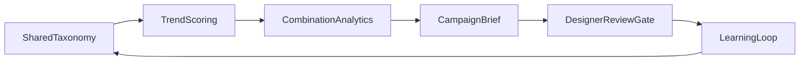
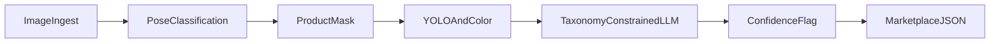
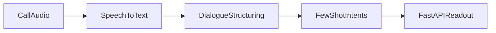

# Bhavesh Soni

Lead AI Engineer designing production AI systems. Targeting AI Architect roles.

Focus: agentic workflows on a shared attribute taxonomy, multimodal extraction, and evaluation before release.

**Bengaluru · Tibil Solutions · [LinkedIn](https://www.linkedin.com/in/bhaveshsoni1) · bhaveshsony19@gmail.com**

## Systems

### 1. Design–marketing flywheel

Four stages on one attribute taxonomy: trend scoring, combination analytics, campaign brief, learning loop. A designer review gate sits in front of every released brief.

[design-marketing-flywheel](https://github.com/Bhavesh-Sony/design-marketing-flywheel)

### 2. Multimodal attribute pipeline

Ingest, pose, mask, structure, color, then a taxonomy-constrained language model. Low-confidence rows are flagged. Marketplace values live in config. Batch, not real time.

[multimodal-attribute-pipeline](https://github.com/Bhavesh-Sony/multimodal-attribute-pipeline)

### 3. Multilingual call intelligence

Speech to text, dialogue structuring, few-shot intents, FastAPI readout. Built for ten languages without a labeled training set.

[multilingual-call-intelligence](https://github.com/Bhavesh-Sony/multilingual-call-intelligence)

## Stack

Python · LangGraph · LangChain · GPT-4o · Gemini · YOLO · Apache Spark · Databricks · FastAPI

## Earlier systems

Forecasting, document Q&A, construction OCR, and detection experiments stay in the older repositories. They are not pinned.

## Contact

bhaveshsony19@gmail.com · [linkedin.com/in/bhaveshsoni1](https://www.linkedin.com/in/bhaveshsoni1)
